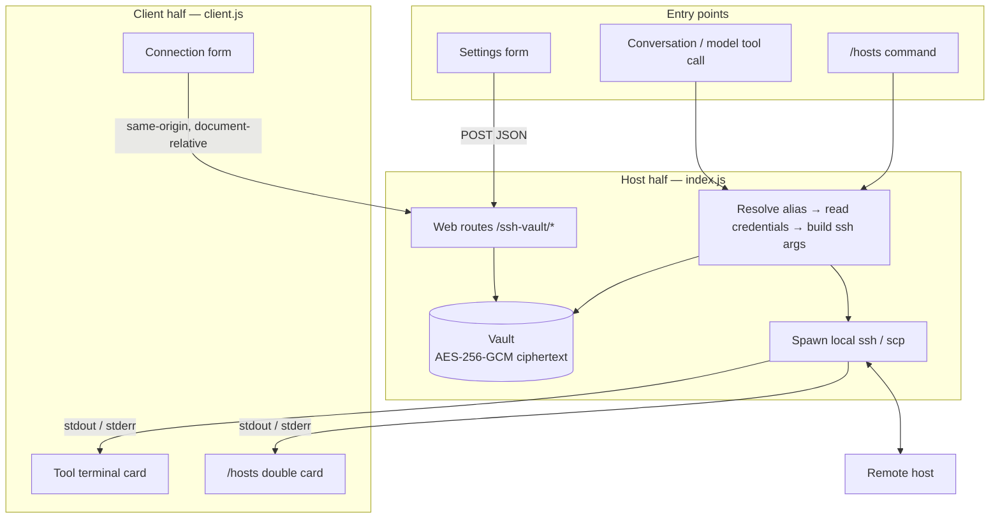

# dsh-ssh-vault

**English** | [简体中文](README.zh-CN.md)

[](LICENSE)
[](package.json)
[](https://github.com/deepseek-ai)
[](package.json)
[](test)

SSH for DeepSeek Harness agents: host address, port, account, password and private key live in an encrypted vault, and the conversation only ever uses an alias. The model never sees a password, and a password never reaches a command line or a remote process list.

## Overview

Three capabilities in one plugin:

- **Model-facing tools** — `ssh_hosts`, `ssh_run`, `ssh_transfer`, `ssh_probe`, so the agent operates remote hosts by alias.
- **Settings UI** — add, edit and delete hosts in Settings → SSH Connections, and test reachability. A password entered there travels in an HTTP body, never through the session log.
- **`/hosts` command** — probe hosts and run commands from the conversation without going through the model.

Under the hood it drives the local OpenSSH client (`ssh` / `scp`). It does not implement the SSH protocol itself.

## Install

```bash
dsh plugin --profile desktop install dsh-ssh-vault
```

From a local checkout. The argument is a path, so `.` works when you are already inside the plugin directory:

```bash
# inside the checkout
dsh plugin --profile desktop install .

# or point at it from elsewhere
dsh plugin --profile desktop install ../dsh-ssh-vault

# or install from a packed tarball
dsh plugin --profile desktop install ./dsh-ssh-vault-<version>.tgz
```

**`--profile` is required.** DSH isolates plugins per profile, and one machine can carry several (`desktop`, `cli`, …). Omitting it falls back to whichever profile is currently default, which is an easy way to install into the wrong place. Confirm the landing spot with:

```bash
dsh plugin --profile desktop list
```

**Restart DSH after installing.** Host-side tools and routes are loaded at startup.

### Requirements

| Item | Requirement |
| --- | --- |
| Node | ≥ 20 |
| Machine | OpenSSH client installed (`ssh` on PATH) |
| Platform | Windows, Linux, macOS |

## Quick start

1. **Install, then restart DSH.**
2. Open **Settings → SSH Connections**, click "Add connection", fill in alias, address, port, account, and choose password or private-key authentication.
   Each card carries a health dot that is checked automatically: grey = not checked, yellow = checking, green = reachable, red = unreachable.
3. Say something in the conversation, for example:

   ```
   run uptime on kali
   ```

   The model calls `ssh_run` and the result appears as a terminal card.

Do not paste passwords into the conversation. A password entered in Settings goes straight into the encrypted vault and never enters the model context.

## Usage

### Model-facing tools

| Tool | Purpose | Typical phrasing |
| --- | --- | --- |
| `ssh_hosts` | Manage the vault (list / show / add / update / remove) | "which hosts do I have", "change kali's note" |
| `ssh_run` | Run a command on a host, return stdout and stderr | "check disk usage on kali" |
| `ssh_transfer` | Upload or download a file (scp) | "copy this file to /tmp on kali" |
| `ssh_probe` | Reachability self-check returning system facts | "is kali still reachable" |

**Where to see the result:** calls to `ssh_run`, `ssh_probe` and `ssh_transfer` render as a **terminal card** — a header with "host · command" and a state dot, above a scrollable monospace output area. The dot is blue while running, grey on success, red on failure (including a non-zero exit code).

### Settings UI

Settings → SSH Connections provides:

- A host list with a health dot per card; hover for detail
- Add / edit / delete connections (the alias is editable, credentials move with it)
- A "Test connection" button per card, whose result also drives the dot
- "Open in file manager" for the vault directory
- Password and private-key authentication; a key can be uploaded whole and is written into the vault with its permissions tightened

### The `/hosts` command

Start a line with `/` in the composer and the command runs **without going through the model**.

```
/hosts                    list every host, grouped into online / offline
/hosts kali               probe one
/hosts kali,win10         probe several (either comma form works)
/hosts kali; apt update   run a command on kali
/hosts kali,win10; uptime run on every reachable host
```

- Separators accept both ASCII and full-width forms: `,` and `，`, `;` and `；`
- If the text after the semicolon reads as natural language (e.g. "check the disk"), the command **does not run it** and tells you to send that sentence to the conversation instead — command output never reaches the model, so such requests cannot go through the command
- Output renders as **two cards**: reachability and command execution, each with its own state dot

## Architecture

### Two halves

This is a **Host + Client** plugin; the two halves load through different mechanisms:

| Half | Entry | Loading |
| --- | --- | --- |
| **Host** | `index.js` | Cordis plugin, inserted into the Loader through `cordis.patch.yml` |
| **Client** | `client.js` | Browser module, declared via `dsh.client` in `package.json` and injected into the page by the host |

The Host half carries every sensitive operation: vault encryption, driving the local `ssh` client, web routes, and the registration of commands and tools.
The Client half only renders and collects form input; it never executes a command.

### Data flow



Three invariants hold across that chain:

1. **A password never reaches a command line** — local ssh receives it through `SSH_ASKPASS`; remote sudo is primed over stdin
2. **Only ciphertext touches disk** — AES-256-GCM, with the data key protected by DPAPI (Windows) or derived from a master passphrase via scrypt
3. **`~/.ssh` is never touched** — `known_hosts` points into the vault directory and `HashKnownHosts` is enabled

## Configuration

The plugin has **no user-configurable options**. `config: {}` in `cordis.patch.yml` is an empty object, and the Loader entry `id` is fixed as `ssh-vault`.

Behaviour is shaped by the following:

| Item | Notes |
| --- | --- |
| Vault directory | Defaults to `$DSH_HOME/ssh-vault`; `DSH_HOME` is decided by DSH |
| Key protection | Windows defaults to `dpapi`; other platforms require a master passphrase (`passphrase` mode) |
| Timeouts | `ssh_run` defaults to 120s, adjustable, capped at 30 minutes; commands inside `/hosts` are fixed at 120s |
| Health checks | Settings page and `/hosts` probe with a 15s timeout; the background sweep refreshes every 5 minutes |

## API and extension points

Host-side services are reached through `ctx.inject` as optional dependencies; a missing service does not fail the plugin, it just disables that capability.

### Model tools (`ctx.tools.register`)

| Tool | Key parameters |
| --- | --- |
| `ssh_hosts` | `action` required (list / show / add / update / remove); `reveal` controls whether address and account are masked |
| `ssh_run` | `host`, `command` required; optional `sudo`, `timeoutMs`, `workdir`, `run_in_background`, `wait_for`, `bindAddress` |
| `ssh_transfer` | `host`, `direction`, `local`, `remote` required; optional `recursive` |
| `ssh_probe` | `host` required; optional `timeoutMs`, `bindAddress` |

The three terminal-style tools also register `presentCall` / `presentResult` hooks, but **the current DSH version has no consumer for them**; presentation is handled by the slots below.

### Client slots (`ctx.slots.register`)

| Slot | Key | Effect |
| --- | --- | --- |
| `settings.section` | `id: ssh-vault`, `order: 20`, `label` | The "SSH Connections" page in the settings panel |
| `tool.call.toolview` | `ssh_run`, `ssh_probe`, `ssh_transfer` | Renders those tool calls as terminal cards |
| `conversation.chat.commandview` | `hosts` | Renders `/hosts` output as two terminal cards |

The `tool.call.toolview` key space is open; none of these three names were taken, so no built-in UI is shadowed.

### Human command (`ctx.commands.register`)

| Command | Notes |
| --- | --- |
| `/hosts` | Probe hosts / run a command on them. Form: `alias[,alias][; shell command]` |

The command is **registered once and never re-registered**. The disposer returned by `commands.register` destroys the current definition; re-registering while the user is typing arguments strips the composer of its command context (backspace stops working, and the UI needs a restart).

### HTTP routes (`ctx.webServer.register`)

Mounted at `/ssh-vault` (`kind: 'prefix'`, **no trailing slash**). `POST` only, JSON in and out, with an envelope of `{ ok: true, value }` or `{ ok: false, error }`.

| Path | Effect |
| --- | --- |
| `/ssh-vault/list` | Host list (address and account masked, no passwords) |
| `/ssh-vault/save` | Create / update / rename |
| `/ssh-vault/remove` | Delete |
| `/ssh-vault/test` | Reachability probe |
| `/ssh-vault/reveal` | Return unmasked address and account |
| `/ssh-vault/openVault` | Open the vault directory in the system file manager |

`openVault` **accepts no path argument at all** — it can only open the plugin's own vault directory.

### About `ctx.systemPrompt.section`

**This plugin does not use that extension point.** Every tool carries its own `description`, and no section is injected into the system prompt, so prompt length and ordering are unaffected.

## Lifecycle

### Startup

1. The Loader reads `cordis.patch.yml` and inserts the entry with `id: ssh-vault`
2. The host `import`s `index.js` and calls `apply(ctx, config)`
3. `apply` opens the vault, registers the four tools, and — where the services exist — the web routes, the `/hosts` command and the background health timer
4. The Client half is injected into the page per the `dsh.client` declaration, and its `apply` registers the three slots

### Unload and resource reclamation

Async resources are wrapped in `ctx.effect`, and Cordis runs the returned cleanups in reverse order on teardown:

- Tool and command disposers
- Web route disposers
- The health sweep's `setTimeout` / `setInterval`
- The vault handle

Vault data **survives uninstall** and is available again after reinstall.

### Hot update

The two halves behave differently, and this is easy to get wrong:

| Change | Takes effect by |
| --- | --- |
| `client.js` and slot rendering | Reinstall the bundle, then **reload the page** |
| `index.js` / `lib/**` | **Restart DSH**; reinstalling does not replace an already-loaded module generation |
| `package.json` `version` | The version shown in Settings is read from this file by the Host |

**Do not infer that the browser has new code from an unchanged slot id** — slot registration reflects the host side, not the module actually running in the page.

## Known limitations

### Platform and authentication

- **`dpapi` key protection is Windows-only.** On Linux and macOS the `passphrase` mode is required (a master passphrase, with the key derived through scrypt)
- **The Settings UI supports only password and private-key authentication.** The `agent` auth type can be set through `ssh_hosts add`, but the form cannot enter or edit it
- **Remote shells supported: bash / sh / cmd / powershell.** Sudo priming applies to POSIX shells only

### Concurrency

- **Connections to one host are serialised in-process.** Every call opens a fresh SSH
  connection, and a burst of them — especially concurrent `scp` — trips sshd's connection
  limits and accumulates failed-auth counters toward an account lock. Background jobs are
  exempt from the queue so a long task does not block that host for everything else.
- **The vault has no cross-process lock.** Two DSH instances (different profiles pointing at the same vault directory) writing at the same time means the later write wins
- Within one profile, writes from several sessions serialize on the event loop, but frequent concurrent edits of the same host are still not advisable

### Account lockout

Windows OpenSSH disconnects a **locked** account outright instead of returning
`Permission denied`, so a locked account looks like a network problem: the port answers, the
banner arrives, then the connection is reset. If "port open, banner fine, still cannot
connect" shows up, check the account before chasing the firewall — `net user <account>` on
Windows, `faillock --user <account>` on Linux. Locking the management account also kills
key-based login, so keep a second administrative path available when experimenting with
lockout policy. `ssh_run` warns before commands that change account state.

### Host keys

`StrictHostKeyChecking=accept-new` is used: **the first connection is trusted automatically**, and any later fingerprint change is refused. There is no separate fingerprint-verification flow, so judging whether a first-time target is trustworthy is up to the operator.

### Output and timeouts

- `ssh_run` caps a single result at 200000 characters and truncates beyond that
- Each command inside `/hosts` echoes at most 40 lines
- Commands inside `/hosts` have a fixed 120s timeout that is not configurable
- Foreground tool calls have **no streaming output**: the result appears in one piece when the command ends. To watch a long job, use `run_in_background`, whose output lands in a job card

### Interface

- The **navigation icon next to "SSH Connections" is drawn by the host from the section id**. The `settings.section` registration accepts only `id` / `order` / `label`, so a plugin cannot supply its own icon
- Command arguments have **no candidate-list mechanism** (`CommandInputDescriptor` carries only `hint` and `attachments`), so `/hosts` cannot offer alias completion

### Open questions

Not verified in detail; check the source or upstream docs before relying on them:

- Whether DSH exposes a structured field for command results, which would replace the textual section markers (`─── 连接状态:ok ───`) used today
- Whether the host will connect a consumer to `presentCall` / `presentResult` in a future version

## Security boundary

### What it touches

| Category | Accessed | Detail |
| --- | --- | --- |
| Filesystem | **Yes** | The vault directory (`vault.json`, `key.json`, `known_hosts`, uploaded key copies) and any private-key path you supply; **never** `~/.ssh` |
| Network | **Yes** | Outbound SSH through the local `ssh` / `scp` processes; loopback HTTP routes (same origin, behind the host trust layer) |
| Terminal | **Yes** | Spawns the local OpenSSH client; `openVault` launches the system file manager |
| External APIs | **No** | No third-party service is contacted |
| User data | **Yes** | Host address, port, account, password, private key, note, tags |

### Password handling

- **Local SSH**: passed through `SSH_ASKPASS`, never on the command line or in a process list
- **Remote sudo**: primed over stdin, never on the remote command line or in `ps`
- **On disk**: only AES-256-GCM ciphertext; the data key is protected by DPAPI or a scrypt-derived key
- **Model context**: a password never appears in tool arguments or results; one entered in Settings travels in an HTTP body and stays out of the session log
- **`credentialRef`**: when a host points at an entry in the Harness credential store, the password is read at connect time and never passes through this plugin

### Trust boundary

The web routes ride on the DSH web server, and unauthenticated requests are refused by its trust layer (401/403). The plugin adds no authentication of its own, so **do not expose the DSH web port to an untrusted network**.

### Reporting a vulnerability

See [SECURITY.md](SECURITY.md).

## FAQ

**"SSH Connections" is missing from Settings after installing.**
Check you installed into the right profile: `dsh plugin --profile <name> list`. Then restart DSH — the client bundle is injected at page bootstrap, so a page reload alone is not enough.

**A tool call reports a missing route, or Settings says the host is still running old code.**
The host code was updated but the process was not restarted. Restart DSH.

**The health dot stays red although the host answers ping.**
The dot tests the **SSH port 22**, not ICMP. Check that `sshd` is running, that a firewall allows the port, and that the address stored in the vault is still current.

**A connection test reports "connection not established within 15000ms".**
Again a network-layer signal: the address changed, a firewall is blocking, or the machine is up without `sshd`. It is unrelated to login credentials.

**A word gets a red squiggle while typing `/hosts`.**
That is why the command is named `hosts`: the composer is a Lexical editor whose plain text nodes are subject to browser spellcheck, and `hosts` is a dictionary word while `ssh` is not.

**`/hosts kali,win10` says "not found".**
Check the alias spelling against the vault; it is case-sensitive. Run `/hosts` with no arguments to list the valid aliases.

**A private key upload is rejected.**
Three common causes: a `.pub` public key was chosen, a PuTTY `.ppk` was chosen (convert it with `puttygen` first), or the file has no `BEGIN … PRIVATE KEY` header.

**Output from several hosts runs together.**
Use the `/hosts host; command` form; the output splits into a reachability card and a command card.

**Client code changed but the interface did not.**
Reload the page. Host-side changes need a DSH restart.

## Contributing

See [CONTRIBUTING.md](CONTRIBUTING.md). The hard rules: **zero runtime dependencies** (Node built-ins only on the Host side; only the host-provided `react` on the Client side), no real credentials or addresses in the repo, and a password must never reach a command line or the session log.

```bash
npm test            # host-free regression suite
npm run test:live   # end-to-end cases against real hosts
```

## License

[MIT](LICENSE)

## Cheat sheet: start · use · stop · uninstall

```bash
# Install (profile required)
dsh plugin --profile desktop install dsh-ssh-vault
dsh plugin --profile desktop install .        # from inside a local checkout

# Confirm where it landed
dsh plugin --profile desktop list

# Reinstall to refresh the installed copy
dsh plugin --profile desktop remove dsh-ssh-vault
dsh plugin --profile desktop install dsh-ssh-vault

# Uninstall
dsh plugin --profile desktop remove dsh-ssh-vault
```

**Starting and stopping** are handled by the DSH process itself: the plugin loads when DSH starts and unloads when DSH exits. It has no separate process and no resident background service.

Uninstalling **does not delete the vault**. Data stays in `$DSH_HOME/ssh-vault` and is usable again after reinstall; delete that directory by hand to remove it entirely.

Everyday reference:

```
Settings → SSH Connections        manage hosts, test reachability, open the vault directory
/hosts                            list hosts and their online state
/hosts kali                       probe one host
/hosts kali,win10; uptime         run a command on several
(just talk)                       let the model pick hosts and call the tools
```
