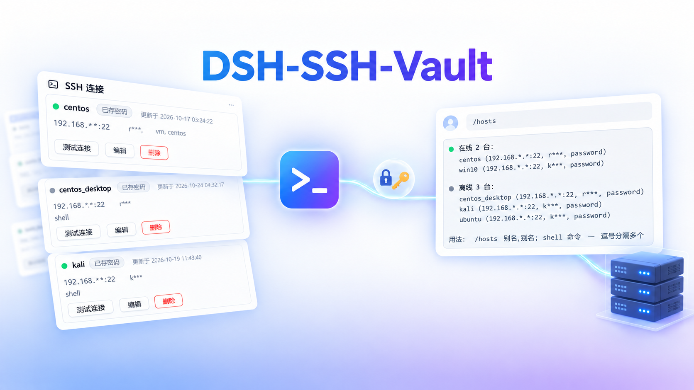
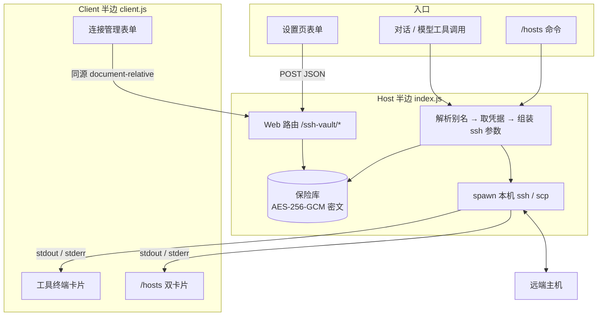

<div align="center">

# dsh-ssh-vault



**简体中文** | [English](README.md)

[](LICENSE)
[](package.json)
[](https://github.com/deepseek-ai)
[](package.json)
[](test)

</div>

给 DeepSeek Harness 的智能体提供 SSH 能力：主机地址、端口、账号、口令与私钥都存进加密保险库，对话里只用别名。模型永远看不到口令，口令也不会出现在命令行或远端进程列表里。

## 简介

**仅支持 Windows。** 保险库数据密钥由 Windows DPAPI 保护，`SSH_ASKPASS` 辅助程序是 Windows 的 `.cmd` 包装器；插件声明了 `os: ["win32"]`，在其它平台上直接拒绝启动，而不是把密钥退化成明文。

三个能力合在一个插件里：

- **模型面向的工具** —— `ssh_hosts`、`ssh_run`、`ssh_transfer`、`ssh_probe`，让智能体按别名操作远端主机。
- **设置界面** —— 在「设置 → SSH 连接」里增删改主机、测试连通性。口令经 HTTP body 提交，不进入会话日志。
- **`/hosts` 命令** —— 人类直接在对话里探测主机、执行命令，不必经过模型。

底层调用本机 OpenSSH 客户端（`ssh` / `scp`），不自带 SSH 协议实现。

## 安装

```bash
dsh plugin --profile desktop install dsh-ssh-vault
```

从本地目录安装。参数是路径，已经在插件目录里时直接用 `.`：

```bash
# 在插件目录内执行
dsh plugin --profile desktop install .

# 或从别处指向该目录
dsh plugin --profile desktop install ../dsh-ssh-vault

# 或从打包好的 tarball 安装
dsh plugin --profile desktop install ./dsh-ssh-vault-<version>.tgz
```

**需要 `--profile`。** DSH 按 profile 隔离插件集，同一台机器可以有多个 profile（如 `desktop` 与 `cli`）。不指定时取决于当前默认 profile，容易出现「装到了别处」。装完用下面的命令确认落点：

```bash
dsh plugin --profile desktop list
```

安装完成后**重启 DSH**。Host 侧的工具与路由在重启后才会加载。

**本插件仅支持 Windows。** `package.json` 声明了 `os: ["win32"]`，因此在 Linux / macOS 上 `dsh plugin ... install` 会直接拒绝安装；从源码加载也会因为同样的原因拒绝启动（见[已知限制](#平台与认证)）。

### 环境要求

| 项 | 要求 |
| --- | --- |
| Node | ≥ 20 |
| 本机 | Windows 10 / 11，且启用 OpenSSH 客户端（`ssh -V` 能输出版本） |
| 平台 | **仅 Windows**（`win32`）——Linux / macOS 上安装与加载都会被拒绝 |

## 快速开始

1. **安装并重启 DSH。**
2. 打开 **设置 → SSH 连接**，点「添加连接」，填别名、地址、端口、账号，选择口令或私钥认证。
   卡片上的圆点会自动体检：灰=未检测、黄=检测中、绿=连通、红=不通。
3. 在对话里说一句话，例如：

   ```
   用 kali 跑一下 uptime
   ```

   模型会调用 `ssh_run`，结果以终端卡片出现在对话中。

口令不要写在对话里。设置界面录入的口令直接进加密保险库，不经过模型上下文。

## 使用方式

### 模型调用工具

| 工具 | 用途 | 典型说法 |
| --- | --- | --- |
| `ssh_hosts` | 管理保险库（list / show / add / update / remove） | 「有哪些主机」「改一下 kali 的备注」 |
| `ssh_run` | 在主机上执行命令，返回 stdout 与 stderr | 「在 kali 上看看磁盘占用」 |
| `ssh_transfer` | 上传或下载文件（scp） | 「把这个文件传到 kali 的 /tmp」 |
| `ssh_probe` | 连接自检，返回系统信息 | 「kali 还连得上吗」 |

**在哪里看到效果：** `ssh_run` / `ssh_probe` / `ssh_transfer` 的调用会渲染成**终端卡片**——标题栏是「主机 · 命令」加一个状态点，下方是可滚动的等宽输出区。状态点：蓝=运行中、灰=成功、红=失败（含非零退出码）。

### 设置界面

「设置 → SSH 连接」提供：

- 主机列表，含连通状态圆点，悬停看详情
- 添加 / 编辑 / 删除连接（编辑时别名可改，凭据随之搬迁）
- 每张卡的「测试连接」，结果同时反映到圆点
- 「用资源管理器打开」保险库目录
- 口令认证与私钥认证；私钥可整份上传，由宿主写入保险库并收紧权限

### 界面语言

插件显示的所有文字都跟随 **设置 → 常规 → 语言**，这里没有另一套开关。

- 设置页与对话内的 SSH 卡片从宿主的 locale 服务取词，语言一换立刻跟着变。
- `/hosts` 输出、连接诊断、设置接口错误、保险库错误与后台任务状态都由 Host 生成；它们读取同一个持久偏好（`locale.preference`）并跟随之后的切换，只有在从未选择过语言时才退回请求的 `Accept-Language`。
- **面向模型的定义保持英文**：工具名、描述与参数 schema 属于模型接口，而不是界面。

### `/hosts` 命令

在输入框里以 `/` 开头，命令**不经模型**直接执行。

```
/hosts                    列出全部主机，按在线 / 离线分组
/hosts kali               探测一台
/hosts kali,win10         探测多台（中英文逗号都行）
/hosts kali; apt update   在 kali 上执行命令
/hosts kali,win10; uptime 在每台可达主机上执行
```

- 分隔符支持中英文：`,` 与 `，`、`;` 与 `；`
- 分号后如果写的是自然语言（例如「帮我看看磁盘」），命令**不会执行**，会提示你直接把它发给对话——命令的产出不回流给模型，这类请求不能走命令
- 输出渲染为**两张卡片**：连接状态、命令执行，各自独立亮灯
- **在 `/` 菜单里选中 `/hosts` 只是「认领」这个命令**：输入框里出现命令 token 与提示。再按一次回车＝无参执行（列出主机）；或者接着输入 `别名; shell 命令` 作为它的参数。想回到普通提示词，删掉这个命令 token 即可——在那之前输入的内容都会被当作命令参数
- **首条消息之前，结果显示在输入框上方。** DSH 把「整段记录只有命令行」的会话视为非活跃视图，所以全新会话里单独跑 `/hosts` 以前看起来像「什么都没发生」，要等发出第一条消息才看到卡片。插件现在会在会话仍空白时把这些 `/hosts` 卡片（含运行中状态）镜像到输入框上方的 dock；首条消息发出后由对话区接管，不会重复显示
- 无参执行只在体检缓存为空时现测，且并行、总预算 4 秒；即使多台主机不可达也能在几秒内给出结果

## 架构

### 双端形态

这是 **Host + Client 双端插件**，两半由不同机制加载：

| 半边 | 入口 | 加载方式 |
| --- | --- | --- |
| **Host** | `index.js` | Cordis 插件，经 `cordis.patch.yml` 插入 Loader |
| **Client** | `client.js` | 浏览器模块，经 `package.json` 的 `dsh.client` 声明后由宿主注入页面 |

Host 承担全部敏感操作：保险库加解密、调用本机 `ssh`、Web 路由、命令与工具注册。
Client 只做呈现与表单，不直接执行任何命令。

### 数据流



三条约束贯穿整条链路：

1. **口令从不出现在命令行**——本地 ssh 经 `SSH_ASKPASS` 取口令；远端 sudo 经 stdin 预置缓存
2. **磁盘上只有密文**——AES-256-GCM 加密，数据密钥由 Windows DPAPI 保护（也可以选择由主口令经 scrypt 派生）
3. **不碰用户的 `~/.ssh`**——`known_hosts` 固定指向保险库目录，并启用 `HashKnownHosts`

## 配置

插件**没有用户可配置项**。`cordis.patch.yml` 里的 `config: {}` 是空对象，Loader 条目的 `id` 固定为 `ssh-vault`。

行为受以下因素影响：

| 项 | 说明 |
| --- | --- |
| 保险库目录 | 默认 `$DSH_HOME/ssh-vault`；`DSH_HOME` 由 DSH 决定 |
| 密钥保护方式 | `dpapi`（Windows DPAPI，默认）或 `passphrase`（scrypt 派生，磁盘上不保存密钥材料）。`file` 会把密钥以明文保存，只能显式选择，且不会被当作回退 |
| 超时 | `ssh_run` 默认 120 秒，可调，上限 30 分钟；`/hosts` 内的命令固定 120 秒 |
| 连通性体检 | 设置页与 `/hosts` 用 15 秒探测超时；后台每 5 分钟刷新缓存 |

## API 与扩展点

宿主侧通过 `ctx.inject` 按可选依赖接入；缺失的服务不会导致插件报错，只是对应能力不启用。

### 模型工具（`ctx.tools.register`）

| 工具名 | 参数要点 |
| --- | --- |
| `ssh_hosts` | `action` 必填（list / show / add / update / remove）；`reveal` 控制地址与账号是否脱敏 |
| `ssh_run` | `host`、`command` 必填；`sudo`、`timeoutMs`、`workdir`、`run_in_background`、`wait_for`、`bindAddress` 可选 |
| `ssh_transfer` | `host`、`direction`、`local`、`remote` 必填；`recursive` 可选 |
| `ssh_probe` | `host` 必填；`timeoutMs`、`bindAddress` 可选 |

三个终端类工具注册了 `presentCall` / `presentResult` 钩子，但**当前 DSH 版本没有消费方**；实际呈现由下面的槽位负责。

### 客户端槽位（`ctx.slots.register`）

| 槽位 | key | 作用 |
| --- | --- | --- |
| `settings.section` | `id: ssh-vault`、`order: 20`、`label` | 设置面板里的「SSH 连接」页 |
| `tool.call.toolview` | `ssh_run`、`ssh_probe`、`ssh_transfer` | 把工具调用渲染成终端卡片 |
| `conversation.chat.commandview` | `hosts` | 把 `/hosts` 输出渲染成两张终端卡片 |

`tool.call.toolview` 的 key 域开放，这三个名字原本未被占用，因此不覆盖任何内置 UI。

三个注册都带 `locale: 'ssh-vault'`——也就是向宿主 locale 服务注册的命名空间——语言切换时卡片才会重新渲染、重新取词。

### 人类命令（`ctx.commands.register`）

| 命令 | 说明 |
| --- | --- |
| `/hosts` | 探测主机 / 在主机上执行命令。格式 `别名[,别名][; shell 命令]` |

命令的 `description` 与 `input.hint` **只在界面语言切换时重新注册**。`commands.register` 返回的 disposer 会销毁当前定义；在用户输入参数期间替换定义，输入框会失去命令上下文（退格失灵，需重启界面）。所以注册绝不由定时器或体检结果驱动；切语言是设置页里的主动操作、当时没有正在输入的命令，是唯一安全的替换时机。

### HTTP 路由（`ctx.webServer.register`）

挂载在 `/ssh-vault`（`kind: 'prefix'`，**无尾斜杠**），仅接受 `POST`，请求与响应均为 JSON，信封为 `{ ok: true, value }` 或 `{ ok: false, error }`。

| 路径 | 作用 |
| --- | --- |
| `/ssh-vault/list` | 主机列表（地址账号脱敏，不含口令） |
| `/ssh-vault/save` | 新增 / 更新 / 改名 |
| `/ssh-vault/remove` | 删除 |
| `/ssh-vault/test` | 连接自检 |
| `/ssh-vault/reveal` | 返回未脱敏的地址与账号 |
| `/ssh-vault/openVault` | 用系统文件管理器打开保险库目录 |

`openVault` **不接受任何路径参数**，只能打开插件自己的保险库目录。

每个请求都会在真正处理之前先过宿主 Connection 的信任栅栏：调用 `ctx.connection.requestRejection(req)`，与 `/api` 使用同一套 Host/Origin 校验与浏览器登录认证。被拒绝的请求得到 `401` / `403`，既不会接触保险库，也无法探测动作是否存在，因此 DNS rebinding 或跨站调用读不到主机数据、也触发不了探测。

### 关于 `ctx.systemPrompt.section`

**本插件未使用该扩展点。** 工具都在定义里自带 `description`，没有向系统提示词注入任何段落，因此不影响提示词长度或顺序。

## 生命周期

### 启动

1. Loader 读 `cordis.patch.yml`，以 `id: ssh-vault` 插入插件条目
2. 宿主 `import` `index.js`，调用 `apply(ctx, config)`
3. `apply` 内完成：打开保险库、注册四个工具、（服务可用时）注册 Web 路由与 `/hosts` 命令、启动后台体检定时器；同时订阅 Host 设置文档，用于读取界面语言并跟随之后的切换
4. Client 半边由宿主按 `dsh.client` 声明注入页面，`apply` 里注册三个槽位，并向 locale 服务注册 `ssh-vault` 字典

### 卸载与资源回收

异步资源都包在 `ctx.effect` 里，Cordis 在销毁时逆序调用返回的清理函数：

- 工具与命令的 disposer（含切语言后的新命令定义）
- Web 路由的 disposer
- 设置文档订阅与启动重试定时器
- 后台体检的 `setTimeout` / `setInterval`
- 保险库句柄
- Client 的 locale 字典与槽位注册

保险库数据**不会因卸载而删除**，重新安装后仍可用。

### 热更新

两个半边的更新语义不同，这点容易踩坑：

| 改动位置 | 生效方式 |
| --- | --- |
| `client.js` 及槽位渲染 | 重装 bundle 后**刷新页面** |
| `index.js` / `lib/**` | **必须重启 DSH**，模块不会因重装而换代 |
| `package.json` 的 `version` | 设置页显示的版本号来自 Host 每次读取该文件 |

**不要用「槽位 id 没变」推断浏览器已加载新代码**——槽位注册状态反映的是宿主侧，不是页面里实际运行的模块。

## 已知限制

### 平台与认证

- **仅支持 Windows。** 数据密钥由 Windows DPAPI 保护，`SSH_ASKPASS` 辅助程序是 Windows 的 `.cmd`；因此仓库声明 `os: ["win32"]`。没有 Linux/macOS 模式：在那类平台上继续运行只能把密钥退化成明文 `key.json`，所以插件直接拒绝加载。SSH 的目标仍可以是 Linux/Unix 主机——限制的是运行 DSH 的这台机器。
- **默认 `dpapi`，也支持 `passphrase`**（主口令经 scrypt 派生密钥）。`file` 会把密钥以明文保存，只能显式选择，不是回退路径。
- **设置界面只支持口令与私钥两种认证。** 工具侧的 `agent` 认证类型可通过 `ssh_hosts add` 设置，但设置界面无法录入或编辑
- **远端 shell 支持 bash / sh / cmd / powershell。** `sudo` 预置仅对 POSIX shell 生效

### 并发

- **同一主机的连接在进程内串行化。** 每次调用都新建 SSH 连接，短时间一批——尤其并发 `scp`
  ——会触发 sshd 的连接数限制，并累积失败认证计数把账户推向锁定。后台任务不进这条队列，
  否则一个长任务会把该主机上其他调用全部堵死
- **保险库没有跨进程锁。** 两个 DSH 实例（不同 profile 指向同一保险库目录）同时写入时，后者覆盖前者
- 同一 profile 内多个会话的写入串行化到事件循环，但仍不建议高频并发修改同一主机

### 账户锁定

Windows OpenSSH 对**已锁定**的账户是直接断开连接，而不是回 `Permission denied`，所以锁定
看起来像网络问题：端口通、banner 正常、然后被重置。遇到"端口通、banner 正常、就是连不上"，
先查账户再查防火墙——Windows 用 `net user <账号>`，Linux 用 `faillock --user <账号>`。
管理账号被锁会连密钥登录一起失效，做锁定策略实验时请保留第二条管理通道；`ssh_run` 在执行
会改动账户状态的命令前会给出警告。

### 主机密钥

采用 `StrictHostKeyChecking=accept-new`：**首次连接自动信任**，之后指纹变化会拒绝连接。插件不提供独立的指纹核对流程，首次连接的目标是否可信需使用者自行判断。

### 输出与超时

- `ssh_run` 单次输出默认上限 200000 字符，超出截断
- `/hosts` 里每条命令最多回显 40 行
- `/hosts` 的命令超时固定 120 秒，不可配置
- 前台工具调用**没有流式输出**：输出在命令结束后一次性出现。需要边跑边看请用 `run_in_background`，输出进 job 卡片

### 界面

- 设置面板里「SSH 连接」的**导航图标由宿主按 section id 绘制**。注册接口（`settings.section`）只接受 `id` / `order` / `label`，插件无法自定义图标
- 命令参数**没有候选列表机制**（`CommandInputDescriptor` 只有 `hint` 和 `attachments`），因此 `/hosts` 无法弹出主机名补全
- 带 `input` 提示的命令从 `/` 菜单里选中时是**被认领而不是立即执行**：这是 DSH 的行为，插件绕不过去。提示（已双语）会写明再按一次回车即无参执行
- **DSH 不会把「只有命令行」的记录当作活跃视图。** `/hosts` 用上面说的输入框上方 dock 镜像补上了这个空档；这条内置规则对其余插件的命令依然成立
- **界面语言读自共享的 Host 设置**，因此同一 Host 接了多个浏览器时，最后写入的偏好生效；DSH Desktop 是单用户界面，这正是预期行为

### 待确认问题

以下内容本次未逐一验证，如需依赖请查源码或上游文档：

- DSH 是否有面向插件的统一「命令结果结构化字段」，用于替代当前 `─── 连接状态:ok ───` 这类文本分节标记
- 宿主是否会在未来版本为 `presentCall` / `presentResult` 接上消费方

## 安全边界

### 访问范围

| 类别 | 是否访问 | 说明 |
| --- | --- | --- |
| 文件系统 | **是** | 保险库目录（`vault.json`、`key.json`、`known_hosts`、上传的私钥副本）与用户指定的私钥路径；**不写** `~/.ssh` |
| 网络 | **是** | 出站 SSH（本机 `ssh` / `scp` 进程）；本机 HTTP 路由（同源，受 Host Connection 信任栅栏保护） |
| 终端 | **是** | spawn 本机 OpenSSH 客户端；`openVault` 会启动系统文件管理器 |
| 外部 API | **否** | 不请求任何第三方服务 |
| 用户数据 | **是** | 主机地址、端口、账号、口令、私钥、备注、标签 |

### 口令处理

- **本地 SSH**：经 `SSH_ASKPASS` 传给 ssh，不进命令行、不进进程列表
- **远端 sudo**：经 stdin 预置 sudo 缓存，不进远端命令行或 `ps`
- **落盘**：只有 AES-256-GCM 密文；数据密钥由 DPAPI 或 scrypt 派生密钥保护
- **模型上下文**：口令从不进入工具参数或返回值；设置界面录入的口令走 HTTP body，不进会话日志
- **`credentialRef`**：若主机记录指向 Harness 凭据存储的条目，口令在连接时读取，从不经过本插件

### 信任边界

Web 路由由 DSH 的 Web 服务器承载，并在处理前向 Host Connection 服务询问是否拒绝（与 `/api` 同一套 Host/Origin 栅栏与浏览器登录认证）。除此之外插件不做自己的鉴权，因此**不要把 DSH 的 Web 端口暴露到不可信网络**。

### 报告安全问题

见 [SECURITY.zh-CN.md](SECURITY.zh-CN.md)。

## 常见问题

**装完后在设置里看不到「SSH 连接」？**
先确认装对了 profile：`dsh plugin --profile <name> list`。然后重启 DSH——Client bundle 在页面引导时注入，仅刷新页面不够。

**工具调用报「路由不可用」，或设置页说「宿主进程仍在运行旧代码」？**
Host 侧代码已更新但进程没重启。重启 DSH。

**设置页的圆点一直是红的，但主机能 ping 通？**
圆点检测的是 **SSH 22 端口**，不是 ICMP。检查 `sshd` 是否运行、防火墙是否放行，以及保险库里的地址是否仍是当前地址。

**测试连接报「连接在 15000ms 内未建立」？**
同样指向网络层：地址变了、防火墙拦截，或主机活着但没起 `sshd`。与登录凭据无关。

**`/hosts` 输入时某个词下面有红色波浪线？**
命令名选 `hosts` 正是为此——输入框是 Lexical 编辑器，普通文本节点受浏览器拼写检查约束，`hosts` 是词典词而 `ssh` 不是。

**输入 `/hosts kali,win10` 后提示「未找到」？**
确认别名拼写与保险库里的完全一致（区分大小写）。`/hosts` 不带参数可列出全部有效别名。

**私钥上传被拒？**
三种常见原因：传了 `.pub` 公钥、传了 PuTTY 的 `.ppk`（需先 `puttygen` 转换）、文件没有 `BEGIN … PRIVATE KEY` 头。

**多台主机的命令输出混在一起看不清？**
用 `/hosts kali; 命令` 的形式，输出会分成「连接状态」和「命令执行」两张卡片。

**DSH 切成英文了，插件里还有中文？**
从 1.15.0 起所有界面文字都跟随 DSH 语言。升级后需要刷新一次页面（Client 半边）并重启一次 DSH（Host 半边）以加载新代码；之后在设置里切语言立即生效，不用再刷新。面向模型的工具定义按设计保持英文。

**Linux / macOS 能用吗？**
不能。数据密钥由 Windows DPAPI 保护，`SSH_ASKPASS` 辅助程序是 Windows 的 `.cmd`；非 Windows 上继续跑只能把密钥以明文落盘，所以插件直接拒绝加载。`package.json` 声明了 `os: ["win32"]`，在其它平台上安装会被拒绝。**远端**主机当然可以是 Linux/Unix——限制的只是运行 DSH 的这台机器。

**改了客户端代码但界面没变？**
刷新页面。改了 Host 代码则需重启 DSH。

## 贡献

见 [CONTRIBUTING.zh-CN.md](CONTRIBUTING.zh-CN.md)。核心红线：**零运行时依赖**（Host 侧只用 Node 内置模块，Client 侧只 require 宿主提供的 `react`）、不提交真实凭据与真实地址、口令不得进入命令行或会话日志。

```bash
npm test            # 免主机的回归
npm run test:live   # 需要真实主机的端到端用例
```

## 许可证

[MIT](LICENSE)

## 速查：启动 · 使用 · 停止 · 卸载

```bash
# 安装（指定 profile）
dsh plugin --profile desktop install dsh-ssh-vault
dsh plugin --profile desktop install .        # 在本地插件目录内执行

# 确认装在哪
dsh plugin --profile desktop list

# 重装以刷新已安装副本
dsh plugin --profile desktop remove dsh-ssh-vault
dsh plugin --profile desktop install dsh-ssh-vault

# 卸载
dsh plugin --profile desktop remove dsh-ssh-vault
```

**启动与停止**由 DSH 进程统一管理：启动 DSH 即加载，退出 DSH 即卸载。插件自身没有独立进程，也不常驻后台服务。

卸载**不会删除保险库**。数据仍在 `$DSH_HOME/ssh-vault`，重新安装后继续可用；如需彻底清除，手工删除该目录。

日常使用速查：

```
设置 → SSH 连接                管理主机、测试连通、打开保险库目录
/hosts                         列出主机与在线状态
/hosts kali                    探测一台
/hosts kali,win10; uptime      在多台上执行命令
（直接说话）                    让模型自己选主机并调用工具
```
